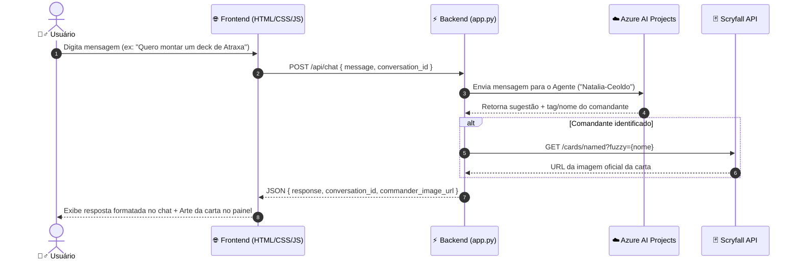

# 🧙‍♂️ Agente Mago Mágico - MTG Commander Deck Builder AI

> Assistente conversacional inteligente especializado no formato Commander de *Magic: The Gathering*, desenvolvido com **Azure AI Foundry (Agent Service)** e integrado à **API do Scryfall**.


---

## 📖 Sobre o Projeto

O **Agente Mago Mágico** é um assistente virtual criado como projeto prático do curso de criação de agentes com **Microsoft Foundry / Azure AI Projects**.

Ele atua como um experiente mago conhecedor do multiverso de *Magic: The Gathering*, auxiliando jogadores veteranos e novatos a:
- Escolher e definir comandantes com base no estilo de jogo (Aggro, Control, Combo, Voltron, Spellslinger, etc.);
- Construir e refinar listas de deck de 100 cartas para o formato Commander;
- Recomendar cartas com sinergia, staples essenciais, cartas de rampa (pedras e acelerações de mana), remoções pontuais e globais;
- Dimensionar curva de mana e balancear a base de terrenos (*manabase*);
- Visualizar em tempo real a arte oficial da carta do comandante selecionado.

---

## ✨ Funcionalidades Principais

- 🧠 **Cérebro Cognitivo com Azure AI Foundry**: Agente de IA customizado gerenciado pelo Azure AI Agent Service, capaz de raciocinar com base nas regras do formato Commander e manter histórico de contexto contínuo por meio do `conversation_id`.
- 🖼️ **Exibição Dinâmica do Comandante (Scryfall API)**: Reconhecimento do comandante mencionado no diálogo (via tag técnica ou extração inteligente por regex) e renderização imediata da carta oficial no painel lateral. Suporta cartas convencionais e de dupla face (*card faces*).
- 💬 **Interface Web Temática (Dark Fantasy)**:
  - Layout dividido (*Split View*): painel da carta à esquerda (proporção oficial de MTG `63:88`) e chat interativo à direita.
  - Paleta escura inspirada no universo de MTG com contraste acessível e toques em laranja místico.
  - Suporte completo a Markdown para formatação de listas de cartas, tópicos, negritos e links.
  - Parser Markdown híbrido e resiliente: utiliza a biblioteca `marked.js` quando disponível e conta com um formatador nativo em JavaScript como fallback automático.

---

## 🏗️ Arquitetura da Solução



---

## 📁 Estrutura de Pastas

```text
agente-mago-magico/
├── .gitignore                      # Arquivos ignorados pelo Git (.venv, chaves, etc.)
├── README.md                       # Documentação do projeto
└── projeto-agente-mago-magico/     # Código-fonte da aplicação
    ├── agente.py                   # Módulo de integração: Azure AI Foundry & Scryfall API
    ├── app.py                      # Servidor Flask com rotas / e /api/chat
    ├── requirements.txt            # Dependências Python do projeto
    ├── static/                     # Arquivos estáticos de frontend
    │   ├── marked.min.js           # Biblioteca para renderização de Markdown
    │   ├── script.js               # Lógica de comunicação assíncrona e eventos do chat
    │   └── style.css               # Estilos da interface (Design Dark Fantasy MTG)
    └── templates/                  # Templates de visualização
        └── index.html              # Página principal (Split View)
```

---

## 🚀 Tecnologias Utilizadas

### Backend
- **[Python 3.10+](https://www.python.org/)**: Linguagem base do backend.
- **[Flask](https://flask.palletsprojects.com/)**: Microframework web para criação dos endpoints HTTP.
- **[Azure AI Projects SDK (`azure-ai-projects`)](https://pypi.org/project/azure-ai-projects/)**: Conexão e orquestração do Agente no Azure AI Foundry.
- **[Azure Identity (`azure-identity`)](https://pypi.org/project/azure-identity/)**: Autenticação com credenciais gerenciadas (`DefaultAzureCredential`).
- **[Requests](https://requests.readthedocs.io/)**: Consumo da API pública do Scryfall.

### Frontend
- **HTML5 & CSS3**: Interface responsiva e estruturada em Flexbox.
- **JavaScript (ES6+)**: Comunicação assíncrona (`fetch`), controle de fluxo do chat e renderização reativa.
- **[Marked.js](https://marked.js.org/)**: Conversor de Markdown para HTML no chat.

---

## ⚙️ Pré-requisitos

1. **Python 3.10 ou superior** instalado na máquina.
2. **Azure CLI** instalado e configurado:
   - Necessário para autenticação local via `DefaultAzureCredential`.
3. Acesso a um projeto configurado no **Azure AI Foundry** com o agente publicado.

---

## 🛠️ Como Rodar o Projeto Localmente

### 1. Clonar o repositório
```bash
git clone https://github.com/natmceoldo/agente-mago-magico.git
cd agente-mago-magico
```

### 2. Criar e ativar o ambiente virtual (opcional, mas recomendado)

**No Windows (PowerShell):**
```powershell
python -m venv .venv
.venv\Scripts\Activate.ps1
```

**No Linux/macOS:**
```bash
python3 -m venv .venv
source .venv/bin/activate
```

### 3. Instalar as dependências
```bash
pip install -r projeto-agente-mago-magico/requirements.txt
```

### 4. Autenticar na conta Azure
Como o projeto utiliza `DefaultAzureCredential`, execute o login pelo Azure CLI no terminal:
```bash
az login
```
> Certifique-se de que a conta autenticada possui permissão de acesso ao recurso do Azure AI Projects especificado em agente.py.

### 5. Iniciar a aplicação Flask
```bash
cd projeto-agente-mago-magico
python app.py
```

### 6. Acessar a aplicação
Abra o seu navegador e acesse:
```text
http://127.0.0.1:5000
```

---

## 🔧 Configurações do Agente

As configurações de conexão com a Azure estão centralizadas no arquivo `projeto-agente-mago-magico/agente.py`:

| Variável | Descrição | Valor Atual |
| :--- | :--- | :--- |
| `ENDPOINT` | Endpoint do recurso de projeto no Azure AI Foundry | `https://aula-agente-lucas-resource.services.ai.azure.com/api/projects/aula-agente-lucas` |
| `AGENT_NAME` | Nome do agente publicado no Microsoft Foundry | `Natalia-Ceoldo` |

> 💡 **Boas Práticas de Produção**: Em ambientes de produção ou repositórios públicos, recomenda-se carregar essas variáveis por meio de variáveis de ambiente (`.env`) utilizando a biblioteca `python-dotenv`.

---

## 🎯 Exemplos de Prompts para Testar

- *"Olá Mago! Quero montar um deck de Commander focado em marcadores +1/+1. Que comandante você me recomenda?"*
- *"Defina o comandante como Krenko, Mob Boss. Me dê 5 cartas essenciais de aceleração e 5 geradores de goblins."*
- *"Pode analisar a sinergia entre Teysa Karlov e criaturas com Afterlife?"*
- *"Como devo distribuir a minha base de mana para um deck tricolor (Esper)?"*

---

## 👩‍💻 Autoria e Créditos

Projeto desenvolvido por **Natália Ceoldo** durante o curso de criação de agentes com **Microsoft Foundry**.

- Repositório: [natmceoldo/agente-mago-magico](https://github.com/natmceoldo/agente-mago-magico)
- Dados de cartas e imagens fornecidos gentilmente pela API aberta do [Scryfall](https://scryfall.com/).
